# AgroLoop

AgroLoop is a full-stack research and circular-supply-chain application for converting
agricultural residue into higher-value fuel and bio-chemical products while connecting
the three groups involved in the process:

1. **Farmers and FPOs** who supply crop residue.
2. **Processing hubs** that receive residue, operate retorts and verify product quality.
3. **Industrial buyers** that purchase bio-coal or pyroligneous acid.

The project implements the proposal for a village-level, decentralized residue
valorization framework. It combines a public research website, role-based operational
portals, procurement and sales ledgers, inventory, quality records, traceability,
mock MRV carbon estimates and report exports.

## Project objective

Open burning of crop residue creates smoke, particulate pollution and loss of soil
organic carbon. Untreated residue can also cause slagging, fouling and corrosion when
used as fuel in industrial equipment. AgroLoop proposes to address this by aggregating
residue at village hubs and processing it with an autothermal pyrolysis retort.

The proposed reference process uses:

- Air-dried residue below 15% moisture.
- Shredded feedstock of approximately 20–40 mm.
- A sealed, double-jacketed batch retort.
- Initial ignition followed by an autothermal transition around 280°C.
- A proposed calibration range of 350–500°C.
- A residence time of approximately 30–60 minutes.
- Recirculation of combustible syngas to sustain thermal operation.

The main outputs are:

- **Bio-coal:** a carbon-rich industrial fuel targeting more than 5,800 kcal/kg HHV.
- **Pyroligneous acid:** a condensate or wood-vinegar product targeting
  approximately 18–25 litres per tonne of residue for biostimulant evaluation.

## How the system works

```mermaid
flowchart LR
  F[Farmer / FPO] -->|Offer residue| H[Village processing hub]
  H -->|Weigh, inspect and purchase| L[Residue intake ledger]
  L -->|Batch process| B[Retort batch]
  B -->|Lab and yield record| Q[Quality test]
  Q -->|Publish verified quantity| M[Product marketplace]
  M -->|RFQ and sale| C[Industrial buyer]
  C -->|Delivery and acceptance| O[Order / sale record]
```



### 1. Farmer or FPO participation

A farmer can register, create a residue offer/listing, enter quantity and moisture,
choose a collection window and view the nearest processing hubs. The hub accepts or
rejects the offer and records collection and weighment. Farmers can view their own
purchase history and purchase receipts.

### 2. Hub processing

A hub receives residue, records gross/tare/net weight, moisture and impurity,
evaluates deductions and creates a procurement transaction. The hub can then create
retort batches, record temperatures and residence time, enter quality results and
publish product lots.

### 3. Industrial buyer participation

A buyer can review public material availability and prices, submit a quantity-based
purchase request, receive a quotation and follow the order/delivery/acceptance stages.
Own sales and balance records are available to the buyer.

### 4. Procurement and sales accounting

The procurement ledger records every farmer purchase using paise-safe server
calculations. The sales ledger records customer organizations, lot-based dispatches,
GST, freight, payments and delivery acceptance. Confirmation updates inventory in
transactions and is audited.

### 5. Traceability and reporting

The platform links farmer lots to intake records, batches, product lots, orders and
estimated carbon records. Hubs can review stock, mass balance and management-estimate
margins. CSV/Excel exports and PDF receipts/invoices provide record-keeping outputs.

## Advantages

- **Lower open-burning pressure:** residue is redirected into a structured market.
- **Additional farmer income:** residue becomes a saleable product instead of waste.
- **Localized processing:** reduces long-distance transport dependency.
- **Lower external-fuel dependence:** target operation uses recirculated syngas after ignition.
- **Fuel standardisation:** laboratory fields support HHV, ash, moisture and grade comparison.
- **Industrial traceability:** buyers can view lot and batch information.
- **Digital procurement and sales records:** reduces manual ledger fragmentation.
- **Transparent estimates:** reference, carbon and economic values are clearly labelled.
- **Inventory control:** purchase, batch and sale movements provide a stock trail.

## Applications

AgroLoop can support:

- Sponge iron and steel-rolling fuel substitution.
- Cement and captive-power boiler fuel planning.
- Rural residue aggregation and FPO operations.
- Village-level retort pilot hubs.
- Farmer payment and purchase record management.
- Bio-coal and pyroligneous-acid quality tracking.
- Academic research on thermochemical optimisation.
- Supply-chain, techno-economic and MRV-style analysis.
- Public demonstration of circular-economy data.

## Role and access model

The application starts on the login page. Public research and material pages remain
available without revealing operational ledgers.

| Role | Primary access |
|---|---|
| PUBLIC | Research, residue/material benchmarks, marketplace and lot lookup |
| FARMER | Own profile, residue offers/listings, nearest hubs and own purchases |
| HUB_OPERATOR | Own hub, intake, procurement, batches, quality, sales, inventory and reports |
| INDUSTRIAL_BUYER | Own company profile, RFQs, orders and purchase/sales records |
| ADMIN | Cross-hub users, data, audit, analytics and configurable settings |

Hub procurement, sales and inventory routes require an authenticated hub or admin.
Farmer and buyer routes use ownership checks. Admin routes are restricted to admin
users.

## User-facing modules

### Public website

- Detailed institutional research page
- Problem, objectives and five-step process
- Residue and fuel benchmark comparisons
- Hub economics calculator
- Literature, references and research gaps
- Marketplace and public lot traceability
- Contact and enquiry pages

### Farmer portal

- Profile and village details
- Residue offer/listing creation
- Moisture, quantity, location and collection window
- Nearest-hub distance view
- Listing status and pickup tracking
- Own purchase details and PDF receipt

### Hub portal

- Listings and intake
- Purchase ledger with mock two-step payments
- Batch and quality records
- Product-lot publication
- Procurement and sales ledgers
- Inventory, mass-balance, margin and ageing reports

### Buyer portal

- Quantity-based purchase request
- Product and lot availability
- Indicative purchase value
- RFQ and order status
- Own sales/invoices and balance

### Admin portal

- User and hub verification
- Reference-data and provenance management
- Platform analytics
- Enquiry inbox
- Audit log
- CSV/Excel data exports
- Ledger settings

## Technology

```text
Frontend: React 18, TypeScript, Vite, React Router
Backend:  Node.js, Express, TypeScript, Zod
Database: PostgreSQL and Prisma
Security: JWT httpOnly cookies, bcrypt, Helmet, CORS and RBAC
PDF:      PDFKit purchase receipts and sales invoices
Testing:  Vitest, Supertest and Playwright
DevOps:   Docker Compose, npm workspaces, GitHub Actions
```

Repository structure:

```text
apps/
  web/       React frontend
  api/       Express API, Prisma and seed
packages/
  shared/    Shared types and Zod contracts
docs/        Detailed component documentation
e2e/         Playwright browser tests
```

## Run locally

Requirements:

- Node.js 24 or later
- npm 11 or later
- PostgreSQL 16, or Docker with PostgreSQL

```powershell
Copy-Item .env.example .env
npm install
npm run prisma -- generate
npm run dev
```

The Windows helper script is also available:

```powershell
.\run-agroloop.ps1
```

Local addresses:

- Web: http://localhost:6999
- API health: http://localhost:4000/health
- Swagger: http://localhost:4000/api/docs

To expose the application to another device on the network, open
`http://SERVER-LAN-IP:6999`. The frontend uses the browser host for API calls rather
than the client device's `localhost`.

For a deployed or reverse-proxy environment, set `VITE_API_URL` to the API origin.
Do not include `/api/v1`; the frontend adds that prefix.

### PostgreSQL setup

```powershell
npm run prisma -- db push
npm run prisma -- db seed
```

Docker startup:

```powershell
docker compose up --build
```

## Demo accounts

Password for all demo accounts: `AgroLoop123!`

| Role | Email |
|---|---|
| Admin | `admin@agroloop.local` |
| Hub operator | `hub1@agroloop.local` |
| Farmer | `farmer1@agroloop.local` |
| Buyer | `buyer1@agroloop.local` |

Additional seeded roles include `farmer2`, `farmer3`, `hub2` and `buyer2`.

## Main routes

| Route | Description |
|---|---|
| `/` | Login entry |
| `/research` | Institutional research and methodology |
| `/data` | Residue benchmarks and hub economics |
| `/marketplace` | Available bio-coal and pyroligneous-acid lots |
| `/lot/:code` | Public lot traceability |
| `/farmer` | Farmer profile and residue offer |
| `/hub` | Hub operating workspace |
| `/buyer` | Buyer material request and orders |
| `/admin` | Administration |
| `/procurement` | Farmer purchase ledger |
| `/sales` | Customer sales ledger |
| `/inventory` | Residue and product inventory |
| `/reports` | Mass balance, margin and ageing reports |

## API and database notes

The API base is `/api/v1`. It uses Zod input validation and a consistent error shape:

```json
{
  "error": {
    "code": "VALIDATION_ERROR",
    "message": "Invalid input",
    "details": null
  }
}
```

Currency fields use integer paise rather than binary floating point. Confirmed
purchases and sales update stock and write audit entries in transactions. Sale
confirmation blocks overselling against remaining lot quantity.

Key database models include `User`, `FarmerProfile`, `HubProfile`, `BuyerProfile`,
`ResidueType`, `ResidueListing`, `IntakeRecord`, `Batch`, `QualityTest`, `ProductLot`,
`Purchase`, `PurchasePayment`, `Customer`, `Sale`, `SaleItem`, `SalePayment`,
`InventoryMovement`, `CarbonEstimate`, `AuditLog` and `LedgerSetting`.

## Testing

```powershell
npm run build
npm test
npm run test:e2e
```

Playwright tests cover public research/data, marketplace filtering, lot lookup,
login and protected ledger-route behavior.

## GitHub and Vercel deployment

The repository contains `vercel.json` and an `/api/index.ts` serverless Express
entrypoint for deploying the frontend and API together.

1. Push the repository to GitHub.
2. Import the repository into Vercel.
3. Vercel should detect the monorepo as a Node application.
4. Set these environment variables in Vercel:

| Variable | Required value |
|---|---|
| `DATABASE_URL` | PostgreSQL connection string, preferably pooled |
| `JWT_ACCESS_SECRET` | Long random secret |
| `JWT_REFRESH_SECRET` | Different long random secret |
| `PUBLIC_APP_URL` | Final Vercel site URL |
| `VITE_API_URL` | API origin, or leave blank for same-origin `/api/v1` |

5. Build command: `npm run vercel-build`
6. Output directory: `apps/web/dist`
7. Run Prisma migration/seed against the deployment database before opening live workflows.

```powershell
npx prisma generate --schema apps/api/prisma/schema.prisma
npx prisma db push --schema apps/api/prisma/schema.prisma
npx prisma db seed --schema apps/api/prisma/schema.prisma
```

For Vercel, use a PostgreSQL provider that supports pooled serverless connections.
Local `uploads/` storage is not durable in serverless functions; production uploads
must use Vercel Blob/S3-compatible object storage.

## Deployment readiness status

The repository is ready for GitHub upload after secrets and environment-specific
configuration are kept outside source control. A live database, production JWT
secrets and production object storage are required before database-backed production
workflows can be considered complete.

Husky is installed only inside a local Git checkout. Vercel and other CI environments
skip Husky setup, preventing `husky: command not found` during dependency installation.

Deployment builds use the workspace-aware `vercel-build` scripts. A redeploy should
clone the current `main` branch rather than reuse an older deployment commit.

## Data integrity and limitations

- All reference values carry provenance: `PROPOSAL_REPORTED`, `LITERATURE`,
  `MODELLED` or `MEASURED`.
- Wheat straw is seeded with pending/null values.
- The proposal's 3,450 kcal/kg average is not treated as the calculated residue mean.
- Carbon figures are labelled **“Estimated, not verified”**, never as verified credits.
- Purchase and sale payments are mock record-keeping, not real payment-gateway activity.
- PDF receipts and invoices are generated locally and are not tax/legal instruments.
- Citations and DOIs must be verified before academic submission.
- Economic and experimental values remain proposal assumptions pending accredited lab work.

## Documentation

- [Frontend documentation](docs/FRONTEND.md)
- [Backend documentation](docs/BACKEND.md)
- [Database documentation](docs/DATABASE.md)
